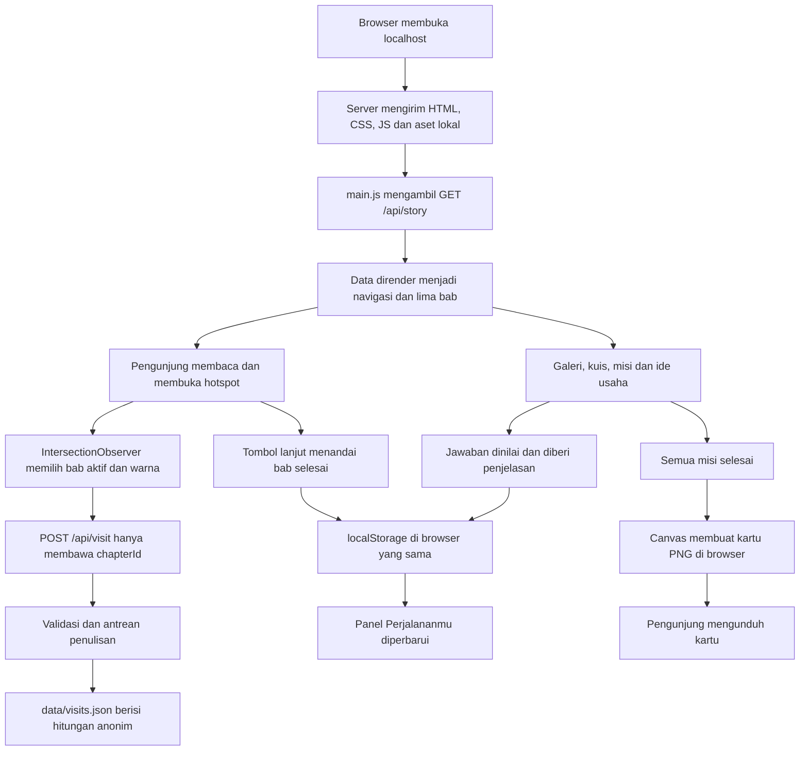

# Jejak Mbako

Cerita interaktif budaya Temanggung: **dari daun jadi karya, dari pemuda menuju 2045**.

Versi **0.4.0 — fase 4: perbaikan dan audit lokal selesai**. Lima bab, peta, hotspot motif, proses membatik, galeri, kuis, tiga misi, enam ide kreatif, dan kartu PNG sudah berfungsi. Fase 4 memperbaiki navigasi dan fokus keyboard, menguji kegagalan penyimpanan serta pemuatan, dan menambah pemeriksaan keamanan serta aset lokal. Nama panggilan, jawaban kuis, dan progres tetap disimpan di browser.

Hasil saat ini: **29 tes lulus**, pemeriksaan sintaks lulus, dan audit npm melaporkan **0 kerentanan** pada 13 Oktober 2026. Aset runtime beserta data cerita berukuran **219.537 byte (sekitar 214,4 KiB)**. Lihat [laporan pengujian](docs/PENGUJIAN.md) untuk bukti dan batas pengujian, serta [panduan demo lomba](docs/DEMO-LOMBA.md) untuk alur presentasi. Pengujian HP fisik, browser lain, pembaca layar, dan pencocokan juknis resmi belum dinyatakan selesai.

## Menjalankan

Prasyarat: Node.js 22 atau lebih baru dan npm.

```powershell
npm ci
npm start
```

Buka **http://localhost:3000**. Untuk memuat ulang server setelah berkas berubah:

```powershell
npm run dev
```

Browser tetap perlu di-reload setelah perubahan HTML, CSS, atau JavaScript. Data `story.json` dibaca ketika server mulai; restart `npm start` setelah menyunting konten.

Port alternatif di PowerShell:

```powershell
$env:PORT = '3001'
npm start
```

Server secara bawaan hanya mendengarkan `127.0.0.1`. `HOST` dapat diatur secara eksplisit jika kelak perlu demo melalui jaringan lokal. Jangan menjalankan dua proses aplikasi yang memakai berkas kunjungan yang sama.

## Status dan keputusan fase 1

- HTML, CSS, dan JavaScript murni; hanya dua dependency runtime: `hono` dan `@hono/node-server`.
- Hero memakai SVG original dengan tiga hotspot dan parallax kecil pada desktop. Gerak dimatikan untuk pointer kasar dan preferensi reduced motion.
- Lima bab memiliki narasi pengantar, pelajaran untuk pemuda, ilustrasi, sumber, dan tombol lanjut. Penyelesaian bab harus dilakukan secara eksplisit melalui tombol lanjut; menggulir saja tidak dianggap selesai.
- Panel Perjalananmu selalu tersedia. Nama panggilan opsional, bab selesai, bab terakhir, progres misi, dan hasil kuis menggunakan satu key localStorage. Misi dan kuis yang semula berupa kerangka kini aktif pada fase 3.
- Foto yang belum siap tidak dimuat; ilustrasi original menjadi pengganti. Tidak ada gambar rusak atau permintaan ke file foto yang belum tersedia.
- Instruksi langsung pengguna pada 13 Oktober 2026 mengizinkan unduhan internet, menggantikan larangan unduhan dalam dokumen awal. Font diunduh dan disimpan lokal bersama lisensi. Tidak ada CDN atau API pihak ketiga pada runtime.
- Tidak memakai rekaman audio atau foto pihak ketiga. Ilustrasi daun tidak menyalin motif resmi Batik Mbako.

## Struktur dan fungsi berkas

| Berkas | Fungsi |
| --- | --- |
| `package.json` | Mendefinisikan perintah aplikasi dan dua dependency server. |
| `package-lock.json` | Mengunci dependency agar pemasangan dapat diulang dengan `npm ci`. |
| `.gitignore` | Mengabaikan dependency, cache, berkas lokal pengujian, variabel lingkungan, dan hitungan kunjungan. |
| `server.js` | Menjalankan Hono, header keamanan, pembatasan permintaan, API konten, dan penyimpanan agregat. |
| `data/story.json` | Menyimpan narasi, sumber, aset, dan struktur konten semua fase. |
| `data/visits.json` | Dibuat saat kunjungan pertama diterima dan hanya berisi hitungan per ID bab. |
| `public/index.html` | Menyediakan struktur semantik halaman, hero, dialog, bantuan, dan tempat rendering bab. |
| `public/assets/css/style.css` | Menetapkan warna, tipografi, layout responsif, fokus, serta aturan reduced motion. |
| `public/assets/js/main.js` | Memuat cerita, merender bab, mengelola navigasi, hotspot, progres, dan dialog. |
| `public/assets/js/story-scenes.js` | Merender peta, hotspot motif, proses, visual 2045, serta garis canting responsif terhadap scroll. |
| `public/assets/js/engagement.js` | Mengelola galeri, kuis, checklist misi, ide usaha, dan pembuatan kartu PNG di browser. |
| `public/assets/js/progress-model.js` | Memvalidasi progres tersimpan, menghitung skor dari jawaban, dan menentukan syarat pembukaan kartu. |
| `public/assets/img/story-map.svg` | Peta cerita original; susunan titik ilustratif, tidak untuk navigasi geografis. |
| `public/assets/img/landscape.svg` | Menggambarkan panorama original dua gunung dan kebun. |
| `public/assets/img/leaf-study.svg` | Menyediakan ilustrasi original studi bentuk daun. |
| `public/assets/img/cloth.svg` | Menampilkan komposisi kain dengan pola daun original. |
| `public/assets/img/canting.svg` | Menyediakan ilustrasi original canting. |
| `public/assets/img/future.svg` | Menggambarkan pertumbuhan sebagai pengantar peran pemuda. |
| `public/assets/img/mark.svg` | Menyediakan tanda daun untuk identitas dan favicon. |
| `public/assets/fonts/*.woff2` | Memuat Fraunces 600 serta Plus Jakarta Sans 400, 500, 700 secara lokal, total sekitar 53,2 KiB. |
| `public/assets/fonts/OFL-*.txt` | Menyertakan lisensi SIL OFL untuk masing-masing keluarga font. |
| `public/assets/fonts/SOURCES.md` | Mencatat versi dan asal distribusi font. |
| `tests/server.test.js` | Menguji API, file statis, pembatasan input, penulisan bersamaan, dan perlindungan data. |
| `tests/story-scenes.test.js` | Menguji batas progres animasi, struktur fase 2, ID tetap, dan referensi sumber konten interaktif. |
| `tests/progress-model.test.js` | Menguji validasi jawaban, skor, misi otomatis, penguncian kartu, kompatibilitas progres lama, dan konten fase 3. |
| `tests/motion.test.js` | Menguji reduced motion, jalur ponsel, penggabungan scroll dalam satu frame, serta pembersihan listener. |
| `scripts/verify-local.mjs` | Memeriksa HTTP seluruh aset lokal, referensi runtime, ukuran font/JavaScript, dan batas ukuran aplikasi. |
| `docs/PENGUJIAN.md` | Mencatat hasil audit fase 4, perbaikan, ukuran aset, serta matriks uji yang masih memerlukan perangkat nyata. |
| `docs/DEMO-LOMBA.md` | Menyediakan alur demo, latihan penjelasan, dan persiapan sebelum penyerahan lomba. |
| `README.md` | Menjelaskan cara menjalankan, penggunaan, struktur, keamanan, konten, serta pengujian fase 1–4. |

## Alur aplikasi



Browser memuat halaman beserta aset lokal. JavaScript meminta cerita dari server, kemudian membentuk bab dan navigasinya. Saat bab masuk area baca, observer mengganti warna dan mencatat kunjungan anonim sekali per bab per pemuatan halaman. Tombol lanjut menyimpan penyelesaian di browser dan membuka bab berikutnya. Ketika halaman dibuka kembali, nama dan progres dipulihkan.

Hitungan kunjungan adalah **jumlah kunjungan bab**, bukan jumlah orang unik. Membuka halaman lagi dapat menambah hitungan. Penghitung ini tidak dipakai untuk memberi nilai atau peringkat pengguna.

## Kode yang penting dan alasannya

1. **`readSmallBody()` dan validasi `chapterId` di `server.js`.** Pembacaan dibatasi 1.024 byte, termasuk untuk body chunked yang tidak mengirim Content-Length. ID harus terdaftar di `story.json`; field tambahan, termasuk nama, ditolak.
2. **`writeQueue` dan `addVisit()`.** Permintaan tulis diurutkan. Setiap operasi membaca hitungan terbaru, menulis `.tmp`, lalu mengganti file tujuan lewat rename. Ini menghindari pembaruan hilang pada satu proses server. Antrean tetap bisa lanjut setelah sebuah operasi gagal; file rusak tidak direset diam-diam.
3. **`validateProgress()` di `progress-model.js`, serta `loadProgress()` dan `saveProgress()` di `main.js`.** Data browser divalidasi sebelum digunakan. JSON rusak kembali ke progres kosong. Jika penyimpanan tidak tersedia, aplikasi tetap berfungsi untuk sesi berjalan dan menjelaskan keterbatasannya.
4. **`renderChapter()` dan helper `element()`.** Konten dimasukkan dengan `textContent`, tidak melalui `innerHTML`, sehingga nama atau teks JSON tidak dijalankan sebagai HTML.
5. **`observeChapters()`.** IntersectionObserver mengamati area baca tanpa pekerjaan berat pada setiap scroll. Warna dipilih dari daftar tema yang terbatas. Bab yang dibaca dan bab yang diselesaikan adalah dua status berbeda.
6. **`makeExplorer()` dan `makeTabs()` di `story-scenes.js`.** Tombol titik dan tab memilih data yang sama. Panel memakai `aria-labelledby`, tab aktif memakai roving tabindex, dan tombol panah/Home/End didukung. Sumber dibangun sebagai tautan HTTPS aman dengan teks biasa.
7. **`createProcess()`.** Satu ilustrasi SVG berganti tahap lewat `data-stage`. Tombol sebelumnya/berikutnya berhenti di batas, tab dapat langsung membuka tahap, dan status dibacakan oleh live region.
8. **`setupCanting()` dan `readingFraction()`.** Posisi bab diukur setelah layout berubah, lalu progres dikunci pada rentang 0–1. Scroll pasif hanya menjadwalkan satu `requestAnimationFrame`; panjang garis tidak dihitung ulang setiap scroll. ResizeObserver menangani perubahan tinggi panel. Mode ponsel memakai garis lurus, sedangkan reduced motion menampilkan garis penuh tanpa tetes bergerak. Listener dapat dibersihkan saat konten dimuat ulang.

## API

| Metode dan endpoint | Hasil |
| --- | --- |
| `GET /api/health` | Status aplikasi dan fase. |
| `GET /api/story` | Seluruh data cerita, tanpa progres pengguna. |
| `POST /api/visit` | Menerima `{ "chapterId": "bab-1" }` dan menambah hitungan anonim. |

Respons sukses pencatatan kunjungan adalah `201 { "ok": true }`. Input salah memberi 400, origin asing 403, body terlalu besar 413, tipe selain JSON 415, dan rate limit 429 disertai `Retry-After`. Error server memberi pesan ramah tanpa stack trace atau jalur berkas.

## Keamanan dan privasi

- Middleware manual memasang CSP dengan sumber `self`, `X-Content-Type-Options`, `X-Frame-Options`, `Referrer-Policy`, `Permissions-Policy`, serta `Cross-Origin-Resource-Policy: same-origin`. Tidak memakai Helmet atau `secureHeaders`.
- HTML dan aset yang belum memakai nama berkas berversi dikirim dengan `Cache-Control: no-cache` agar browser memeriksa ulang setelah aplikasi diperbarui. Endpoint API memakai `no-store`.
- Tidak ada login, cookie, database, analytics, atau data identitas pada server.
- Rate limit 90 permintaan API per menit per alamat koneksi. IP dibaca lewat `getConnInfo`, berada di memori, dan tidak ditulis ke disk atau log. Entri kedaluwarsa dibersihkan pada permintaan berikutnya; maksimum 10.000 entri.
- `X-Forwarded-For` tidak dipercaya. Jika dipasang di belakang reverse proxy, alamat yang terlihat adalah alamat proxy; konfigurasi proxy/rate limit perlu ditinjau sebelum hosting produksi.
- Endpoint POST memeriksa Origin bila dikirim dan menolak `Sec-Fetch-Site: cross-site`. Tidak membuka CORS.
- Hanya `/`, `/index.html`, dan `/assets/*` disajikan sebagai file publik. File sumber server, package, dan data mentah tidak dapat diambil sebagai file statis.
- Batas body dan timeout membantu membatasi penggunaan sumber daya. Antrean file ditujukan untuk satu proses demo, bukan beberapa worker atau banyak instance produksi.
- Kegagalan pencatatan kunjungan tidak menghentikan pembacaan cerita. Tidak ada pengiriman ulang data pribadi.
- LocalStorage menggunakan key `jejak-mbako.progress.v1`. Reset hanya mengganti data key aplikasi ini, tidak memanggil `localStorage.clear()`.
- Tautan sumber dibuka di tab baru dengan `noopener noreferrer`. Membuka situs sumber memerlukan internet; membaca aplikasi tidak memerlukannya.

## Mengubah konten

Edit `data/story.json`, pertahankan ID yang sudah ada, lalu restart server. ID dipakai untuk progres dan validasi kunjungan; menggantinya akan membuat progres lama pada ID tersebut diabaikan.

Struktur utama: `meta`, `hero`, `bab`, `peta`, `motifHotspot`, `proses`, `galeri`, `kuis`, `misi`, `ideUsaha`, dan `sumber`. Tema bab yang didukung: `kabut`, `lereng`, `mori`, `daun`, `nila`.

Setiap bab memiliki ID, nomor, judul, tema, ringkasan, paragraf, pelajaran, ilustrasi, sumber, dan label tombol berikutnya. Rendering rail, daftar bab, dan jumlah progres mengikuti data. Hotspot hero saat ini memakai tiga posisi bernama `gunung`, `kebun`, dan `kota`.

Peta, motif, dan proses sudah aktif. `peta.points` memakai posisi `x`/`y` dalam persen ilustrasi, teks, sumber, serta catatan verifikasi bila perlu. `motifHotspot` memakai pola data serupa. `proses` memakai ID tetap `pola`, `malam`, `warna`, dan `lorod` untuk memilih keadaan ilustrasi.

Galeri, kuis, misi, dan ide usaha juga dirender dari data. Setiap entri `galeri` memiliki `title`, `description`, `illustration`, dan `illustrationAlt` di samping metadata foto. Soal `kuis` memakai `id`, `question`, `options`, indeks `answer` mulai dari 0, `feedback`, dan `sourceIds`. Misi `kind: "quiz"` otomatis mengikuti penyelesaian kuis; `kind: "manual"` memakai checklist. Ide usaha memuat `skill` dan `firstStep` untuk memberi langkah awal; gagasan ini adalah inspirasi, bukan klaim kelayakan bisnis. Pertahankan setidaknya satu soal, satu misi, dan satu gambar galeri. Jika mengubah isi atau urutan soal secara besar, gunakan ID soal baru agar jawaban lama tidak dinilai sebagai jawaban atas soal baru.

## Sumber dan verifikasi

Sumber utama yang digunakan meliputi [profil Pemkab Temanggung](https://mediacenter.temanggungkab.go.id/frontend/d_profil/45), [artikel Posong dari Pemkab](https://smartcity.temanggungkab.go.id/frontend/d_informasi/214), [abstrak penelitian motif Batik Mbako dari Telkom University](https://openlibrary.telkomuniversity.ac.id/pustaka/files/152788/abstraksi/pengembangan-motif-batik-mbako-untuk-busana-anak-anak.pdf), dan [Bappenas tentang kualitas remaja](https://www.bappenas.go.id/index.php/id/berita/peningkatan-kualitas-remaja-untuk-hadapi-bonus-demografi).

Daftar lengkap beserta batas verifikasi disimpan dalam `sumber` dan ditampilkan melalui panel Sumber & kredit. Riwayat jumlah motif/paten disimpan sebagai catatan penelitian, tidak disajikan sebagai inventaris atau status hukum terkini. Nama inisiator, arti motif tertentu, detail pewarnaan, dan beberapa lokasi masih diberi `[PERLU DIVERIFIKASI]`. Tidak ada angka ketinggian gunung atau proyeksi demografi yang dikarang.

## Mengganti foto

**Mode sementara:** `public/index.html` memakai `data-media="kosong"` pada elemen `body`. Area gambar hero, bab, peta, motif, proses, visual penutup, dan galeri tampil kosong dengan ukuran tetap. Logo dan kartu hasil misi tetap tampil. Berkas ilustrasi disimpan agar dapat dipakai kembali. Setelah foto original siap, hapus atribut `data-media="kosong"` untuk mengaktifkan kembali visual, lalu ikuti langkah berikut.

1. Siapkan foto milik sendiri atau foto dengan izin/lisensi yang jelas, lalu simpan di `public/assets/img/`.
2. Periksa isi, asal lokasi, orang yang dapat dikenali, dan izin pemakaian; jangan menghapus watermark untuk menutupi hak pihak lain.
3. Perbarui `src`, `alt`, `kredit`, serta `status` pada seluruh referensi foto tersebut di `story.json`.
4. Ubah `status` dari `sementara` ke `siap` setelah verifikasi. Gunakan `src` lokal yang diawali `/assets/`.
5. Restart server dan reload browser. Jika foto siap gagal dimuat, ilustrasi SVG kembali digunakan.

Foto berstatus sementara sengaja digantikan ilustrasi original. Server mencetak satu peringatan per file sementara. Galeri fase 3 memberi label “Ilustrasi original” dan kredit yang menjelaskan bahwa foto dokumentasi belum tersedia. Foto baru dimuat setelah statusnya `siap`; foto siap yang gagal dimuat kembali memakai ilustrasi pengganti. Jika kelak menambahkan mode penayangan foto sementara, foto tersebut wajib memakai lencana “foto sementara” sesuai brief.

| File rencana | Penggunaan | Tindakan sebelum pengumpulan |
| --- | --- | --- |
| `dua-gunung.jpg` | Hero dan galeri | Foto asli berlisensi; pastikan identitas gunung dan izin fotografer. |
| `alun-alun.jpg` | Bab 1 dan galeri | Gunakan foto dokumentasi asli, bukan render yang diklaim foto nyata. |
| `tugu-jam.jpg` | Galeri | Verifikasi lokasi dan hak penggunaan. |
| `batik-daun-cokelat.jpg` | Bab 3 dan galeri | Verifikasi asal motif serta lisensi; jangan mengklaim motif sebagai Batik Mbako tanpa bukti. |
| `batik-daun-biru.jpg` | Galeri | Verifikasi asal motif serta lisensi. |
| `pembatik.jpg` | Bab 4 dan galeri | Gunakan foto berizin, termasuk persetujuan yang sesuai untuk orang yang dikenali. |

Keenam file foto belum disertakan. Semua visual yang tampil saat ini adalah SVG original. Font berlisensi OFL diambil melalui Fontsource dan tidak menjadi dependency tambahan aplikasi.

## Cara menguji fase 1

Jalankan pemeriksaan otomatis:

```powershell
npm run check
npm test
```

Tes menggunakan port acak dan file sementara terpisah dari `data/visits.json`. Cakupannya meliputi aset dan header, skema cerita, input valid/ilegal, batas body biasa/chunked, origin, 20 penulisan paralel, file rusak, route privat, serta rate limit. Hasil fase 1: **13 tes lulus (12 skenario dan satu tes induk)**.

Pengujian melalui antarmuka:

1. Jalankan `npm start`, buka halaman, dan pastikan hero serta font termuat.
2. Buka tiga hotspot. Tutup lewat tombol, Escape, atau area di luar dialog. Buka Cara menjelajah.
3. Pilih Mulai cerita. Gulir dan periksa penanda bab serta perpindahan warna latar.
4. Tekan Lanjut ke Bab 2. Panel harus menunjukkan 1 dari 5 bab. Memilih bab lain tanpa tombol lanjut tidak menambah bab selesai.
5. Buka Perjalananmu, masukkan nama panggilan uji, lalu simpan. Reload; nama dan progres harus tetap ada.
6. Selesaikan kelima bab. Panel harus menunjukkan 5 dari 5; status misi berubah hanya melalui kuis dan checklist Beraksi.
7. Pilih Mulai ulang perjalanan, coba Batal, lalu ulangi dan konfirmasikan. Nama dan progres aplikasi harus kosong kembali.
8. Pada viewport 390 × 844 dan 320 × 740, pastikan tidak ada scroll horizontal, menu dapat dibuka/ditutup, dan tombol lanjut dapat dijangkau. Cek desktop 1280 × 900.
9. Gunakan Tab, Shift+Tab, dan Enter. Fokus harus terlihat; dialog menahan fokus selama terbuka dan mengembalikannya setelah ditutup.
10. Aktifkan preferensi sistem mengurangi gerakan; perpindahan halaman dan parallax harus berhenti beranimasi.
11. Untuk tes penyimpanan rusak, ubah hanya key aplikasi ini menjadi JSON tidak valid melalui alat pengembang, lalu reload. Untuk storage diblokir, gunakan pengaturan browser profil uji; cerita harus tetap dapat dibaca.
12. Setelah dependency terpasang, putuskan internet sambil membiarkan server lokal hidup. Reload dan coba membaca bab serta menyimpan progres. Jangan memakai mode DevTools yang memblokir seluruh jaringan termasuk localhost untuk mensimulasikan internet terputus.

Pemeriksaan browser awal dilakukan pada browser Chromium tertanam: hotspot, progres, nama, reload, menu ponsel, tampilan desktop/ponsel, dan log konsol. Pengujian lintas browser, reduced motion melalui pengaturan sistem, storage diblokir, offline penuh, serta perangkat fisik tetap menjadi bagian matriks pengujian fase 4.

**Makna offline fase 1:** tidak ada kebutuhan koneksi internet setelah dependency terpasang; server lokal Node tetap harus berjalan. Ini belum merupakan PWA yang bisa dibuka ketika server dimatikan. Situs tidak memasang service worker.

## Tiga pertanyaan juri

**Mengapa memakai localStorage dan file JSON sekaligus?**

LocalStorage menyimpan nama panggilan serta progres di perangkat pengguna. File JSON server hanya menyimpan jumlah kunjungan bab anonim. Pemisahan ini membuat aplikasi sederhana tanpa mengumpulkan identitas.

**Bagaimana mencegah hitungan hilang ketika beberapa pengunjung membuka bab bersamaan?**

Satu antrean Promise mengurutkan penulisan. File sementara ditulis dahulu, kemudian diganti secara atomik melalui rename. Ini sesuai untuk satu proses server demo; beberapa instance memerlukan penyimpanan terkoordinasi.

**Bagaimana menambah konten tanpa mengubah banyak kode?**

Bab, teks, sumber, dan konten fase berikutnya berada di `story.json`. JavaScript merender daftar bab dan progres dari data itu. Struktur ID dan field dipertahankan, lalu server dimulai ulang.

## Fase 2: alur dan keputusan

- **Bab 1:** mengenal tanah dan tempat melalui peta enam titik. Pilih titik atau tab untuk mengganti cerita, lokasi, pertanyaan pengamatan, dan sumber. Peta bukan alat navigasi; posisi serta jarak bersifat ilustratif.
- **Bab 2:** menghubungkan hasil bumi, kerja manusia, dan pengamatan bentuk. Pertanyaan refleksi tidak mengarang kesaksian petani.
- **Bab 3:** riwayat Batik Mbako disertai sumber dan batas verifikasi. Tiga hotspot menjelaskan bentuk, garis, dan pengulangan pada ilustrasi original; tidak mengklaimnya sebagai motif resmi perajin.
- **Bab 4:** stepper pola → malam → warna → lorod memperlihatkan perubahan kain. Keterangan membedakan proses umum dan hasil eksperimen pewarna daun tembakau dari praktik setiap perajin.
- **Bab 5:** lima jejak bertemu pada visual 2045, diikuti refleksi tentang peran pemuda. Animasi dekoratif tidak menentukan progres selesai.

Semua ilustrasi tetap berupa SVG lokal; fase 2 tidak menambah library, foto, audio, CDN, atau pengiriman data pengguna. Referensi baru mencakup Pemkab/Kecamatan, UNY, ISLAH UIN Salatiga, BBKB Kemenperin, dan jurnal UNESA. Tautan lengkap ada di `story.json` dan panel sumber. Semua ID bab serta key progres fase 1 dipertahankan.

## Cara menguji fase 2

Jalankan `npm run check` dan `npm test`. Hasil: **17 tes lulus**, meliputi 13 tes server yang sudah ada dan empat tes tambahan untuk rentang progres, struktur konten, serta referensi sumber fase 2. Tes tidak mengubah berkas kunjungan aplikasi utama.

1. Restart server agar memuat `story.json` versi 0.2.0 atau lebih baru, lalu reload browser. Baca lima bab dan periksa tombol penyelesaian tetap memperbarui Perjalananmu.
2. Buka Peta dari menu. Klik keenam titik dan tab nama tempat. Panel, nama tab aktif, dan sumber harus sesuai. Catatan verifikasi harus tampil pada titik sentra batik dan sejarah Pringapus.
3. Gunakan Tab untuk mencapai daftar pilihan; panah kanan/kiri, Home, dan End harus memilih tab, memperbarui panel, serta mempertahankan satu tab dalam urutan Tab. Tombol titik tetap dapat dijangkau terpisah.
4. Pada bab 3, pilih ketiga unsur motif melalui titik dan tab. Ilustrasi harus tetap diberi kredit sebagai karya original, bukan motif resmi.
5. Pada bab 4, jalankan semua tahap melalui tombol berikutnya, sebelumnya, dan tab. Tombol sebelumnya mati pada tahap pertama; berikutnya mati pada tahap terakhir. Fokus berpindah ke tab yang terlihat ketika tombol aktif mencapai batas.
6. Gulir dari hero sampai bab 5 lalu kembali. Garis dan tetes malam mengikuti posisi baca; lima garis penutup bertemu menuju 2045. Mengubah pilihan peta yang memiliki teks lebih panjang tidak boleh merusak posisi garis.
7. Ulangi pada viewport 390 × 844 dan 320 × 740. Tidak boleh ada luapan horizontal; titik peta minimal 48 × 48 piksel, menu ponsel menutup setelah dipilih, dan garis canting berubah menjadi lurus.
8. Aktifkan reduced motion dari preferensi sistem dan ulangi. Garis harus penuh tanpa animasi/tetes bergerak; semua konten dan interaksi tetap tersedia.
9. Buka Cara menjelajah serta Sumber & kredit, lalu periksa tidak ada galat JavaScript atau pelanggaran CSP di konsol.

Pemeriksaan browser fase 2 dilakukan pada Chromium tertanam dengan viewport desktop 1280 × 900, serta ponsel 390 × 844 dan 320 × 740. Klik titik, tab/panah/Home/End, perubahan tahap, batas tombol, fokus, menu ponsel, penyimpanan progres setelah reload, dan panel 15 sumber bekerja. Tidak ditemukan luapan horizontal, galat JavaScript, atau pelanggaran CSP pada alur yang diuji. Garis canting berubah mengikuti scroll dan lima garis penutup mencapai akhir; ponsel memakai jalur lurus. Pratinjau tersimpan di `.qa/phase-2-map.jpg`.

Pemeriksaan otomatis tidak menggantikan uji pembaca layar, perangkat fisik, dan lintas browser. Preferensi reduced motion melalui pengaturan sistem tetap menjadi bagian pemeriksaan manual fase 4. Aplikasi tetap memerlukan server lokal berjalan untuk penggunaan tanpa internet.

## Tiga pertanyaan juri — fase 2

**Mengapa memakai peta ilustratif?**

Peta membantu menghubungkan tempat dengan cerita melalui aset ringan yang bisa dibaca tanpa API internet. Label menjelaskan bahwa posisi serta jarak bukan acuan navigasi, dan lokasi kunjungan yang belum pasti diberi catatan verifikasi.

**Bagaimana animasi tetap ringan dan dapat diakses?**

Garis memakai SVG dan satu jadwal render per frame saat scroll, dengan pengukuran ulang hanya ketika layout berubah. Ponsel memakai garis sederhana, reduced motion meniadakan gerak, dan makna cerita tetap hadir sebagai teks.

**Bagaimana membedakan fakta budaya dan tafsir visual?**

Narasi mengutip sumber yang dapat ditelusuri. Data sejarah atau lokasi yang belum pasti diberi `[PERLU DIVERIFIKASI]`. Motif layar diberi kredit sebagai karya original, tanpa mengarang filosofi adat atau menyalin motif resmi.

## Fase 3: alur dan keputusan

Browser mengambil cerita dari `/api/story`, lalu `engagement.js` membentuk enam slide galeri, soal kuis, misi, dan ide usaha. Pengunjung menjawab satu soal, membaca penjelasan serta sumber, kemudian melanjutkan sampai hasil akhir. Jawaban dan hasil disimpan melalui model progres yang sama dengan cerita. Semua soal selesai otomatis menandai misi kuis; dua misi lain ditandai pengunjung setelah dilakukan. Ketika semua misi selesai, canvas membuat kartu dengan nama panggilan opsional dan menyediakan unduhan PNG.

- **Galeri:** scroll-snap, seret mouse/pen, gulir sentuh bawaan browser, tombol sebelumnya/berikutnya, panah keyboard, Home/End, dan indikator posisi. Enam slide memakai ilustrasi original lokal, dengan keterangan dan kredit.
- **Kuis:** tiga soal tanpa batas waktu, satu pilihan per soal, penjelasan benar/salah, sumber, skor akhir, ulasan semua jawaban, dan tombol ulangi. Memuat ulang halaman melanjutkan soal yang belum dijawab atau menampilkan hasil yang sudah selesai.
- **Misi:** kuis selesai otomatis tanpa ambang skor; dua checklist merupakan catatan mandiri, tanpa unggahan bukti. Membatalkan satu misi mengunci kartu kembali. Mengulang kuis membuka kembali misi kuis sampai seluruh soal dijawab; dua misi manual tetap tersimpan.
- **Ide kreatif:** enam panel yang dapat dibuka dengan klik atau keyboard. Tiap gagasan menjelaskan keterampilan yang dilatih dan langkah awal; kelayakan usaha tetap perlu diuji bersama pelaku lokal.
- **Kartu:** PNG 1200 × 760, digambar di browser setelah font lokal siap. Nama kosong menjadi “Penjelajah”. Nama dan gambar tidak dikirim ke server; tautan unduhan lama dibersihkan ketika nama/status berubah. Jika canvas gagal, tersedia tombol coba lagi.
- **Progres lama:** key `jejak-mbako.progress.v1` dipertahankan. Nama dan progres bab fase sebelumnya tetap dibaca. Skor lama tanpa daftar jawaban diabaikan agar hasil tidak dianggap selesai tanpa jawaban yang valid.

Fase 3 tidak menambah dependency, endpoint, layanan eksternal, foto pihak ketiga, atau audio. Tilt/pseudo-3D kain bersifat opsional dalam brief dan tidak ditambahkan. Semua fungsi utama dapat digunakan tanpa efek itu.

### Kode penting fase 3

1. **`gradeQuiz()` dan `validateProgress()`.** Skor dihitung dari ID dan pilihan yang valid secara berurutan, bukan mempercayai angka skor dari localStorage. ID misi asing dan duplikat dibuang; misi kuis diturunkan dari penyelesaian jawaban. Ini menjaga konsistensi data, bukan mekanisme antikecurangan—kuis bersifat pembelajaran lokal.
2. **`setupGallery()`.** Pointer events menangani seret mouse/pen, sedangkan sentuhan menggunakan gulir bawaan browser. Setelah dilepas, slide terdekat dipilih. Tombol di ujung menjadi nonaktif dan fokus tetap berada pada kontrol yang tersedia.
3. **`renderQuiz()` dan `sync()`.** Satu hasil progres memperbarui kuis, misi, panel perjalanan, serta kartu. Pilihan yang sudah diperiksa terkunci sampai soal berikutnya agar skor dan penjelasan tidak bertentangan.
4. **`updateCard()` dan `paintCard()`.** Pembuatan kartu menunggu font, menggambar teks dengan canvas, lalu mengubahnya menjadi Blob PNG lokal. Nomor versi membuang hasil asinkron yang sudah usang saat pengguna cepat mengganti nama atau membatalkan misi. URL Blob dicabut ketika diganti agar tidak menumpuk.

### Cara menguji fase 3

1. Jalankan `npm run check` dan `npm test`, lalu restart `npm start` agar konten versi 0.3.0 atau lebih baru dimuat. Reload browser.
2. Buka Galeri. Seret ke kiri/kanan, gunakan tombol panah, lalu fokuskan galeri dan coba ←, →, Home, End. Indikator harus sesuai; tombol berhenti pada gambar pertama/terakhir.
3. Buka Kuis. Pilih satu jawaban salah dan periksa penjelasan, jawaban benar, serta sumbernya. Coba radio dan tombol menggunakan Space/Enter.
4. Reload setelah satu jawaban. Soal berikutnya harus muncul, sementara jawaban sebelumnya tetap tersimpan. Selesaikan kuis dan periksa skor serta panel ulasan jawaban.
5. Buka Beraksi. Hanya misi kuis yang otomatis selesai. Tandai dua misi manual setelah dilakukan; kartu terbuka pada 3 dari 3 misi.
6. Atur nama panggilan lewat tombol di bagian kartu atau Perjalananmu. Unduh PNG dan buka berkasnya: nama, judul, serta ukuran 1200 × 760 harus benar. Coba tanpa nama untuk melihat “Penjelajah”.
7. Batalkan satu checklist: kartu dan unduhan harus terkunci. Tandai lagi, lalu reload: nama, skor, misi, dan kartu harus pulih.
8. Pilih Ulangi kuis. Soal pertama muncul, misi kuis terbuka kembali, dua checklist manual tetap ada, dan kartu terkunci sampai kuis selesai.
9. Buka tiap ide kreatif dengan klik atau Enter pada judul. Keterampilan dan langkah awal harus terlihat. Ulangi alur pada viewport 390 × 844, 320 × 740, serta desktop 1280 × 900; halaman tidak boleh meluap horizontal.
10. Untuk menghapus data uji, buka Perjalananmu → Mulai ulang perjalanan → konfirmasi. Lakukan hanya pada profil uji atau bila memang ingin menghapus progres aplikasi ini.

Hasil pemeriksaan otomatis: **24 tes lulus** dan seluruh pemeriksaan sintaks lulus. Tujuh tes baru mencakup skor yang dihitung ulang, jawaban tidak valid, penyelesaian kuis walau skor nol, pengulangan dan penguncian kartu, data lama, Unicode, serta referensi konten/aset fase 3. Tes server juga memeriksa kedua modul JavaScript baru.

Pengujian Chromium tertanam memverifikasi seret galeri, tombol dan keyboard, umpan balik benar/salah, hasil 2/3 dan 3/3, kelanjutan setelah reload, misi otomatis/manual, penguncian ulang kartu, pengulangan kuis, nama panggilan, panel ide dengan keyboard, serta unduhan PNG yang benar-benar tersimpan dan dibuka. Reset melalui antarmuka mengembalikan kuis, misi, dan kartu ke kondisi awal. Tidak ditemukan galat JavaScript atau pelanggaran CSP pada alur tersebut. Pemeriksaan viewport desktop 1280 × 900 serta ponsel 390 × 844 dan 320 × 740 tidak menemukan luapan halaman horizontal. Bukti lokal ada di `.qa/phase-3-desktop.jpg`, `.qa/phase-3-mobile.jpg`, `.qa/phase-3-small-card.jpg`, dan `.qa/phase-3-card.png`.

### Tiga pertanyaan juri — fase 3

**Mengapa misi kuis selesai meskipun tidak semua jawaban benar?**

Tujuannya belajar. Pengunjung tetap membaca jawaban benar, penjelasan, dan sumber; skor menunjukkan pemahaman saat itu tanpa menghalangi langkah beraksi.

**Bagaimana kartu dibuat tanpa layanan atau akun tambahan?**

Canvas menggambar teks serta dekorasi memakai font lokal, lalu `toBlob()` menghasilkan PNG. Browser mengunduh berkas melalui URL Blob; nama dan gambar tidak diunggah ke server.

**Apakah aplikasi membuktikan pengguna benar-benar menjalankan misi?**

Tidak. Dua misi adalah checklist mandiri. Kartu merupakan kenang-kenangan belajar, bukan sertifikat kompetensi atau bukti terverifikasi. Pendekatan ini menghindari pengumpulan bukti dan identitas pengguna.

## Fase 4: perbaikan dan pemeriksaan akhir

Alurnya: jalankan tes server dan model progres, periksa ukuran serta referensi aset lokal, buka aplikasi melalui browser, uji navigasi dan alur hingga unduhan kartu, perbaiki temuan, lalu catat hasil dan batas verifikasi. Fase ini tidak menambah dependency runtime maupun layanan pihak ketiga.

### Perubahan kode yang penting

1. **Navigasi dan fokus di `main.js`.** Penanda menu mengikuti bagian yang dibuka dan dibaca, dengan `aria-current`. Tautan bagian memindahkan fokus ke judul tujuan, termasuk peta yang memakai `h3`. Dialog memutar Tab/Shift+Tab di antara kontrolnya dan mengembalikan fokus ketika ditutup. CSS menampilkan fokus pada judul/panel yang dapat difokuskan dan menyisakan ruang gulir bawah untuk Perjalananmu.
2. **Penyimpanan di `progress-model.js`.** `readStoredProgress()` membedakan JSON rusak dari akses storage yang diblokir; `writeStoredProgress()` mengembalikan hasil tanpa menjatuhkan aplikasi. Progres sesi tetap ada ketika penyimpanan penuh atau ditolak. Nama dipotong tanpa membelah pasangan karakter Unicode.
3. **Pemulihan `loadStory()`.** Kegagalan pemuatan membersihkan observer, animasi, dan panel lanjutan sebelum menampilkan tombol Coba lagi. Pengunjung tidak ditinggalkan dengan interaksi setengah aktif.
4. **Header di `server.js`.** CORP membatasi pemakaian resource lintas origin, dan cache direvalidasi agar berkas lama tidak tertinggal setelah perubahan. Tes baru mencakup traversal terenkode Windows, metode tulis ke aset, hitungan ilegal/penuh, serta pemulihan antrean setelah gagal.
5. **Verifikasi animasi dan aset.** Tes canting membuktikan 100 kejadian scroll digabung menjadi satu frame, panjang jalur tidak dihitung ulang setiap scroll, reduced motion menampilkan garis penuh, dan cleanup menghentikan pekerjaan. `verify:local` melayani serta membaca seluruh aset lewat HTTP loopback dan memeriksa bahwa referensi aset tidak memerlukan CDN.

### Menjalankan pemeriksaan final

```powershell
npm run check
npm test
npm run verify:local
npm audit --omit=dev
npm start
```

Tiga pemeriksaan pertama dapat dijalankan tanpa internet setelah dependency tersedia. `npm audit` memerlukan akses registry dan hasilnya berlaku pada waktu pemeriksaan. Perintah verifikasi memakai port acak, tidak menambah hitungan kunjungan utama, dan menutup servernya sendiri. Angka latensi localhost bukan ukuran performa HP.

Urutan uji antarmuka: buka bantuan dan coba Tab/Shift+Tab/Escape → buka Peta dari menu → selesaikan lima bab dengan tombol lanjut → jawab kuis → tandai misi yang sudah dilakukan → ubah nama → unduh kartu → reload → pastikan progres pulih. Ulangi pada layar sempit. Gunakan profil uji untuk reset agar progres pribadi tidak hilang. Detail hasil dan langkah pengujian lanjutan ada di [PENGUJIAN.md](docs/PENGUJIAN.md).

### Tiga pertanyaan juri — fase 4

**Apa bukti aplikasi sudah diuji?**

Ada 29 tes otomatis untuk API, keamanan input, penyimpanan, kuis, progres, dan animasi; ditambah uji antarmuka Chromium, empat ukuran viewport, pemulihan error, sinkronisasi antar-tab, dan berkas PNG hasil unduhan. Laporan memisahkan tes yang sudah dilakukan dari yang memerlukan perangkat lain.

**Bagaimana memastikan aplikasi bisa dipakai tanpa internet?**

Kode, font, SVG, serta data cerita dilayani dari server lokal. Pemeriksaan aset memastikan tidak ada CDN pada referensi runtime yang diperiksa. Laptop tetap harus menjalankan Node; situs bukan PWA dan tautan sumber eksternal tetap memerlukan internet. Uji dengan koneksi internet benar-benar diputus dicatat sebagai langkah verifikasi pada laptop demo.

**Apakah 0 kerentanan berarti aplikasi pasti aman dan siap lomba?**

Tidak. Audit npm hanya memeriksa advisory dependency yang diketahui. Tes proyek menguji batas input, origin, header, route privat, dan penulisan data; kesiapan akhir juga memerlukan uji perangkat nyata, verifikasi konten/izin aset, serta pencocokan dengan juknis resmi lomba.

Implementasi empat fase sudah tersedia untuk demo lokal. Penetapan siap pengumpulan mengikuti daftar pemeriksaan di panduan demo; tidak ada klaim sertifikasi aksesibilitas, hasil benchmark HP, atau kelulusan persyaratan panitia yang belum diuji.
